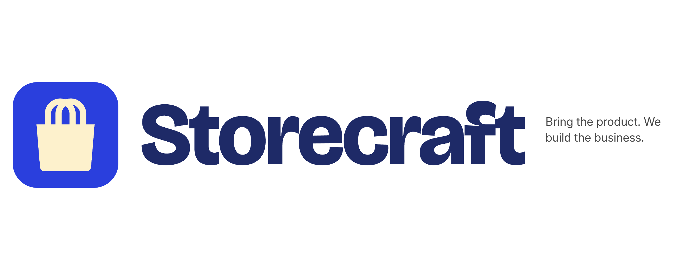

# {{PRODUCT_NAME}}

> **Bring the product. We build the business.**

Shopify was built for people who build stores. We're built for people who make things.

{{PRODUCT_NAME}} is an AI-native Shopify, built for AI from day one. Tell us what you sell and upload a few product photos. A team of AI agents builds the business for you: brand, copy, product images, and a live landing page.

**Demo example:** "I sell homemade cookies" + 3 photos → brand kit, copy, polished images, and a live store page.

## Brand



**Cobalt & Butter.** The product stays a calm frame so each merchant's generated brand is the star.

| Color | Hex | Use |
|---|---|---|
| Cobalt | `#2340E6` | Primary accent, CTAs, logo mark (white text, 7.1:1) |
| Navy | `#1B2A6B` | All text, wordmark (13.2:1 on white) |
| Butter | `#FFF1C7` | Soft surfaces, logo bag |
| Paper | `#FFFFFF` | Background |
| Graphite | `#4A4A4A` | Secondary text |
| Rule | `#E6E6E6` | Dividers |

**Type:** Bricolage Grotesque 800 (display), Inter 400/500 (body), JetBrains Mono (labels).
**Voice:** Plainspoken. Confident. On the maker's side.

Assets live in [`brand/`](brand): `mark.svg`, `mark-navy.svg`, PNG versions, the lockup, and [`brand.json`](brand/brand.json) for the frontend to read colors and fonts from. The wordmark uses the working name "Storecraft" until the product name is final.

## Event

- **Event:** Universal Hackathon, AWS Builder Loft SF, Monday Oct 19, 2026
- **Track:** Commerce, Retail & Consumer
- **Challenge:** Build a business run by a team of 5+ AI agents that use tools and do real work, not just talk.
- **Timeline:** Hacking ends and demos/judging start at 6:00 PM. Target a working demo by 5:30 PM.

## The agents

Each agent is an n8n workflow. Agents hand work to each other through BAND, so every handoff is visible during the demo.

| Agent | Job | Input | Output |
|---|---|---|---|
| Coordinator (CEO) | Reads user input, makes the plan, assigns tasks, checks results | Product description + photos | Task list, final summary |
| Branding | Name, logo idea, colors, fonts, tone of voice | Product description + photos | Brand kit (JSON) |
| Copy | Headline, product descriptions, about section, CTA | Product info + brand kit | Copy (JSON) |
| Image | High-quality product images | User photos + brand kit | Image URLs |
| Landing Page | Builds and deploys the store page | Brand kit + copy + images | Live URL |
| App (LingCode) | Turns the business into a mobile app | Brand kit + copy + images + landing page | App project (stretch goal) |

### Coordinator (CEO)
The team lead. It reads the user's product description and photos, writes a plan, and assigns tasks to the other agents. It runs first and last. At the start it posts the plan to BAND. As work comes back, it checks each agent's output. At the end it posts the live URL and a summary of what the team built.

### Branding
Creates the business's identity: a business name, a logo concept, a color palette, font choices, and a tone of voice. It runs first after the Coordinator, because every other agent depends on its output. It produces a **brand kit (JSON)** that it hands to Copy, Image, Landing Page, and App.

### Copy
Writes all the words on the store: the headline, product descriptions, an about section, and a call to action. It uses the brand kit so the tone matches the brand. Its output is **copy (JSON)**. It runs at the same time as the Image agent.

### Image
Turns the user's raw product photos into high-quality, on-brand product images, using the brand kit's colors and style. Its output is **image URLs**. It runs at the same time as the Copy agent.

### Landing Page
Waits until both Copy and Image are done. Then it combines the brand kit, copy, and images into a store page and deploys it. Its output is a **live URL**, the money shot of the demo.

### App (LingCode), stretch goal
Uses [LingCode](https://lingcode.dev) to turn the finished business into a native iOS/Android app project, based on the brand kit, copy, images, and landing page. LingCode is slow, so it runs last. If it doesn't finish in time, we show the generated project.

## Order of work

Handoffs matter, and the judges look for them.

```
User input
    │
    ▼
1. Coordinator ── posts the plan
    │
    ▼
2. Branding ── brand kit goes to every agent below
    │
    ├──────────────┐
    ▼              ▼
3. Copy        3. Image        (run in parallel)
    │              │
    └──────┬───────┘
           ▼
4. Landing Page ── builds and deploys → live URL
           │
           ▼
5. App (LingCode) ── stretch goal
           │
           ▼
6. Coordinator ── posts the final result: live URL + summary
```

## Tools

- **[n8n](https://n8n.io):** each agent is built as an n8n workflow. Required.
- **[BAND](https://band.ai):** where agents talk to each other and hand off work. Handoffs should be visible in BAND during the demo.
- **[LingCode](https://lingcode.dev):** powers the App agent. Builds native iOS/Android projects. Stretch goal.
- **[Snyk](https://snyk.io):** security scan of the repo before the demo. Required by the rules (code review, quality checks, security).
- **[Masky](https://masky.ai):** avatars and voices for the agents. **On hold** until we confirm whether it's required. The UI leaves room for an avatar per agent.

## Team split

- **Backend (other developer):** n8n workflows, BAND setup, agent logic, model calls.
- **Frontend (Claude Code):** the web UI described below.

## Frontend scope

1. **Input screen:** a "What are you selling?" text box, a photo upload (1 to 5 images), and a **Launch** button.
2. **Team screen:** one card per agent showing its name, role, status (waiting / working / done), and latest message. Handoffs appear as they happen. Each card has a placeholder avatar.
3. **Results screen:** the brand kit, copy, images, and the live landing page link, shown big and obvious. Plus the app result if it exists.

Until the backend is ready, the frontend runs on mock data so the UI is demo-ready either way.

## API contract (proposed, confirm with the backend dev)

```
POST /launch
  body:     { description, images[] }
  response: { job_id }

GET /status/:job_id
  response: {
    agents:  [{ name, status, message }],
    results: { brand, copy, images, landing_url, app }
  }
```

The frontend polls `/status` every 2 seconds, or uses webhooks/SSE if the backend offers them.

## Build rules

- Ship the core path first: input → Branding → Copy + Image → live landing page. Everything else is extra.
- Every step must do real work. A real live URL at the end is the money shot.
- No secrets in the repo. API keys go in `.env`, and `.env` goes in `.gitignore`.
- Run Snyk before the demo and fix anything high or critical.
- Keep it simple: no auth, no payments, and no database unless the backend needs one.

## Demo script (about 3 minutes)

1. **Intro:** "Shopify was built for people who build stores. We're built for people who make things."
2. **The problem:** a home baker wants to sell cookies but has no brand, no site, and no time.
3. Type "homemade cookies", upload photos, and hit **Launch**.
4. Show the agents working and handing off in real time (BAND + team screen).
5. Open the live landing page.
6. **Closing line:** "Bring the product. We build the business."

## Open questions

- [ ] Is Masky required? (Ask organizers on Discord.)
- [ ] What hosts the landing page? (Ask backend dev.)
- [ ] Which image model does the Image agent use? (Ask backend dev.)
- [ ] Product name: TBD. Top candidate is Storecraft. Until it's decided, use `{{PRODUCT_NAME}}` everywhere (UI and README) so the final name is a one-line swap.
